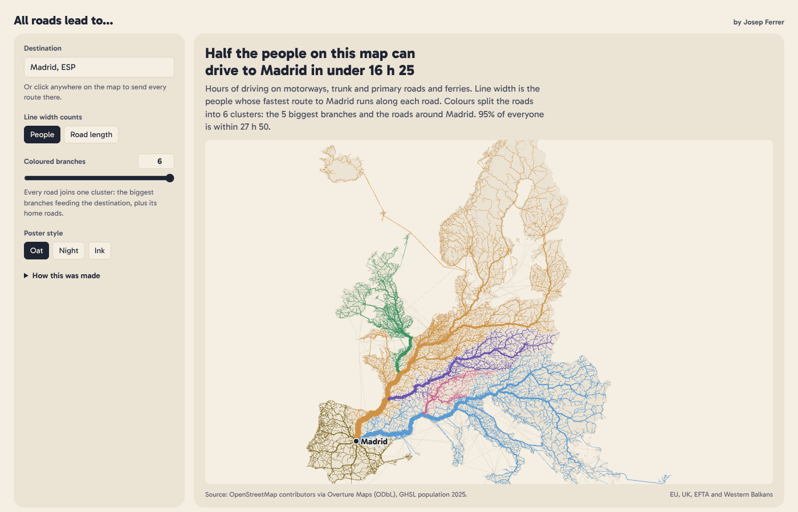

# All roads lead to…

An interactive map of the fastest driving routes to any city across the EU, the UK, EFTA and the Western Balkans. Pick a destination and every main road in the network routes to it: line width shows how many people use each road on their way there, and colours split the network into clusters.



## What you can do

- **Pick a destination.** Type a city or click anywhere on the map. Every junction routes there along its fastest path.
- **Clusters.** Up to 6 colours show the big road systems feeding the destination, plus the city's home roads. Drag the slider or type the number.
- **People or road length.** Line width counts either the people whose route passes along each road, or the kilometres of road that drain into it.
- **Three poster styles:** Oat, Night and Ink.

## Run it

The page loads its data with `fetch`, so open it through a local web server rather than as a file:

```bash
python -m http.server 8000
# then open http://localhost:8000
```

## How it works

**1. Extract** (`pipeline/extract.py`). DuckDB reads the public [Overture Maps](https://overturemaps.org) transportation data straight from S3 and keeps motorways, trunk roads, primary roads and ferry routes inside the bounding box: about 2.7 million segments.

**2. Build** (`pipeline/build.py`, about 2 minutes).
- Keeps the countries in scope; bridges such as Øresund and the Great Belt are kept even though their midpoints are over water.
- Sets a speed per road: the signed limit where there is one, otherwise 120, 100 and 80 km/h by road class and 60 on slip roads. Ferries run at 35 km/h with 20 minutes to board at each end; the Channel Tunnel shuttle takes 65 minutes.
- Bridges short gaps left by the missing minor roads with straight links at 40 km/h, links ferry terminals to the nearest road, drops cruise-like ferry loops, and keeps the largest connected network.
- Removes short dead ends and merges chains of road pieces into single links (661k junctions, 1.0M links).
- Gives every road the people who live closest to it, from the GHSL 2025 population grid (538 million people in total).
- Packs everything into `data/graph.bin.gz` (6.5 MB), stored as byte-shuffled columns so gzip compresses them well.

**3. Page** (`index.html`). Decodes the graph and runs Dijkstra in the browser (about 0.25 s for one destination). It then adds up people along the route tree to get line widths, and builds the clusters: it keeps splitting the biggest branch at its next fork until there are enough balanced branches, colours each trunk like a river by its biggest tributary, and gives side roads the colour of the road they join. Drawing uses [deck.gl](https://deck.gl).

## Rebuild the data

```bash
pip install -r pipeline/requirements.txt
bash pipeline/download.sh      # Natural Earth + GHSL population into data_raw/
python pipeline/extract.py     # road network from Overture into data_raw/ (~490 MB)
python pipeline/build.py       # writes data/graph.bin.gz and data/meta.json
python pipeline/check.py       # drive times from Brussels as a sanity check
```

`build.py` peaks at about 6 GB of RAM. To use a newer Overture release, change `RELEASE` at the top of `extract.py`.

## Repository layout

```
index.html            the map (HTML, CSS and JS in one file)
data/
  graph.bin.gz        routing graph (built)
  meta.json           cities and country outlines (built)
pipeline/
  download.sh         static inputs
  extract.py          road network from Overture
  build.py            graph builder
  check.py            sanity check
  requirements.txt
docs/                 screenshots
```

## Limits

- Only motorways, trunk and primary roads. Secondary and local roads are left out, so short gaps between main roads are bridged with straight links that can show up when you zoom in close.
- No traffic, tolls, turn costs or one-way rules.
- Ukraine, Belarus, Moldova, Russia and Turkey are not included, and Cyprus has no link to the network.

## Data and credits

- Roads and ferries: © [OpenStreetMap](https://www.openstreetmap.org/copyright) contributors, via [Overture Maps](https://docs.overturemaps.org/attribution/). Open Database License (ODbL).
- Population: [GHSL GHS-POP R2023A](https://human-settlement.emergency.copernicus.eu/), epoch 2025, European Commission Joint Research Centre. CC BY 4.0.
- Country outlines and cities: [Natural Earth](https://www.naturalearthdata.com/). Public domain.
- Idea: [Todos los caminos llevan a…](https://ntizar.github.io/CuencasTrafico/) (Spain) and Arterial Mapping's *All Roads Lead to Richmond*.

Made by Josep Ferrer.
